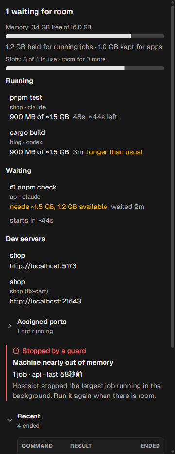

# Hostslot

[](https://github.com/ryusenkei-inc/hostslot/actions/workflows/ci.yaml)
[](https://github.com/ryusenkei-inc/hostslot/releases)
[](LICENSE)

Run more coding agents in parallel without freezing your machine.

Hostslot schedules what parallel coding agents share on one machine:

- **Capacity for heavy commands.** Type checks, test runners and builds start when there is room in memory and CPU; the rest wait their turn, and a runaway is stopped before it takes the machine down
- **A port for each dev server.** Every worktree's dev server gets its own port, and agents are told the URL, so they never reach another worktree's server



## Quick start

**In [Orca](https://github.com/stablyai/orca):** add the Hostslot plugin, open its panel from the status bar and press **Install Hostslot**. It downloads the release for your OS, checks it, and connects Claude Code and Codex.

**Without Orca:**

1. Download the archive for your OS from [Releases](https://github.com/ryusenkei-inc/hostslot/releases) and put `hostslot` on your `PATH`, or `go install github.com/ryusenkei-inc/hostslot/cmd/hostslot@latest` (Go 1.26+)
2. `hostslot setup` registers the hooks of Claude Code and Codex
3. `hostslot doctor` checks the setup

From then on, your agents' heavy commands go through Hostslot and their dev servers get their own ports. `hostslot status` shows what runs and waits. To upgrade, replace the binary (on Windows, rename the running `hostslot.exe` first) and run `hostslot setup`.

```sh
hostslot run -- pnpm test      # waits for room, then runs pnpm test
hostslot serve -- pnpm dev     # runs the dev server on this worktree's port
```

## Why

Several agents, each in its own worktree, start `tsc`, test suites and builds at the same time. On a 16 GB machine that exhausts memory: everything freezes and the OOM killer takes agents with it. Their dev servers also start on the same default ports, and some quietly move to the next one, so an agent's tests reach another worktree's app. Agent IDEs can cap the number of agents, but nothing coordinates what the agents run.

### Why at the process level

| Reason | |
| --- | --- |
| Tool limits don't add up | `--maxWorkers` or an IDE's agent limit each bound one program; four agents that respect theirs still start four type checks together |
| The cost is in commands | Agents cost little while they think. Gating their heavy commands, not the agents, keeps many agents working and lets only the heavy parts take turns |
| Only the OS sees it all | The process tree shows a command's real memory, children included, in any language; the OS can also act on it (priority, Job Objects, signals) |
| It works with anything | A command line in, the same command out: one scheduler for agents, people, git hooks and scripts |

The OS's own tools don't queue: cgroups and Job Object limits make a capped build fail instead of wait, early-OOM killers act after memory is gone, and the scheduler has no notion of jobs worth waiting for. Hostslot uses those mechanisms and adds a queue, priorities and learned costs.

### Hostslot and Orca

Hostslot is made for Orca first, and the two do different jobs: Orca runs, shows and paces agents; Hostslot schedules what the agents start, across the whole machine. As of Orca 1.4.25x:

| Need | Orca | Hostslot |
| --- | --- | --- |
| See memory use | Resource Manager: per-session CPU and memory, kill a session by hand | Per-job memory, held memory, why jobs wait, recent outcomes |
| Limit agents | Orchestration runs 4 tasks at a time by default; restores pause when the process count grows fast | Advisory room for more work; agents are not gated |
| Keep heavy commands from piling up | Not covered | Admits each when slots and memory allow; the rest queue by priority |
| Know a command's cost | Not covered | Learns peak memory and duration per repository |
| Share CPU fairly | Not covered | Lower OS priority and inner parallelism per job |
| Stop a runaway | Not covered (on Linux, one OOM kill no longer takes every terminal) | Per-job ceiling, out-of-memory stop, cleanup of leftovers |
| Dev-server ports | Shows listening ports per workspace | Gives each worktree's dev server its own port and tells the agent the URL |
| Scope | Orca's terminals | The whole machine: any editor or terminal, agent hooks, git hooks, scripts |

### Compared with similar tools

| | File-lock wrappers | Generic command queues | OS limits (cgroups, Job Objects) | Per-worktree port tools | **Hostslot** |
| --- | --- | --- | --- | --- | --- |
| Scope | Commands you wrap | Commands you submit | Processes you put under them | Dev servers you start through them | Everything that runs heavy commands or dev servers on the machine: agents, editors, terminals, git hooks, scripts |
| Heavy commands wait instead of piling up | Yes, by a fixed count | Yes, by a fixed count | No: capped work fails | — | Yes, admitted by free slots and free memory |
| Knows what a command costs | No | No | You set the limit | — | Learns peak memory and duration per repository and command |
| People before agents | No | Manual priorities | No | — | Interactive jobs first; agents at a lower OS priority |
| Shares CPU inside jobs | No | No | CPU quotas | — | Sets each job's worker count (test runners, workspace concurrency) |
| Stops a runaway | No | No | At the limit, as an allocation failure | — | Per-job ceiling and out-of-memory stop, with a clear exit code; leftover processes cleaned up |
| Dev-server ports | — | — | — | A port per worktree | A port per worktree, handed to the tool (Vite included) and told to the agent |
| Agents need no new habits | A rule or wrapper to remember | Submit through the queue | Set up per process | A command or env file per worktree | Hooks rewrite heavy and dev-server commands in place, pipes and `&&` included |
| Shows what runs and waits | No | Its own list | No | Ports in use | Status bar and panel in Orca, `hostslot status` |
| Windows, macOS, Linux | Mostly macOS and Linux | Varies | One OS each | Varies | All three |

## How it works

| | |
| --- | --- |
| **Slots** | `floor((total memory x 0.6 - reserve) / 2 GB)`, at most the CPU count: 4 on a 16 GB machine |
| **Admission** | A job needs free slots for its weight and free memory for its estimate, on top of `reserveMB` kept for the editor, browsers and agents. Running jobs that are still growing hold back the rest of their estimate. When nothing runs, the next job always starts |
| **Order** | Interactive jobs (a person at a terminal) before background jobs (agents, scripts), first come first served; the head of the queue blocks later jobs, so a heavy job is never starved |
| **Learning** | Each command's peak memory and duration, per repository (see [What it learns](#what-it-learns)) |
| **CPU share** | Background jobs run at a lower OS priority. Each job gets its share of CPUs in `VITEST_MAX_WORKERS`, `npm_config_workspace_concurrency`, `pnpm_config_workspace_concurrency` and `HOSTSLOT_WORKERS` (not under `CI`, never overriding a set value) |
| **Nesting** | A `hostslot run` inside a gated job runs directly (`HOSTSLOT_JOB` is set), so hooks, git hooks and scripts can wrap each other without deadlock |
| **Daemon** | Started by the first `hostslot run`, over a Unix socket or named pipe; exits after 10 idle minutes. A newer version retires an older daemon, which finishes its jobs first. Without a daemon, one machine-wide lock per slot (no queue order) |
| **Crash safety** | A job holds its slot through an open connection or OS lock; if it dies, the slot comes back |

### Guards

| Guard | What happens | Exit code |
| --- | --- | --- |
| Memory ceiling | A job whose process tree passes `jobCeilingFraction` of total memory (default 75%) is stopped | `77` |
| Out of memory | When free memory falls below half of `reserveMB`, the largest background job is stopped (at most one per 10 s; never interactive jobs, nor jobs using less than a quarter of `reserveMB`, which would free next to nothing) | `77` |
| Cleanup | Processes a job leaves running (test workers, browsers) are stopped when it ends; `--keep-children` keeps them | — |
| Wait limit | `--max-wait` gives up on waiting; the command never runs without a slot | `75` |
| Timeout | `--timeout` stops the job after it has run that long | `124` |

## What counts as heavy

You decide with `hostslot run`. The integrations decide like this:

| Integration | Gated |
| --- | --- |
| Agent hooks (Claude Code, Codex) | Each heavy command in the line, rewritten in place (see [Claude Code](#claude-code)); the rest of the line runs as written |
| git pre-push | The push's `check` script |
| Package scripts | Whatever you wrap |

A command is heavy when it is one of:

- a package script named `check`, `test`, `build`, `lint`, `typecheck`, `test:*` or `build:*` (`pnpm`, `npm`, `yarn`, `bun`, also with `-r` / `--filter`)
- a package script whose body runs a heavy command, whatever its name (`pnpm tc:web` when `tc:web` is `tsc --noEmit …`), from the nearest `package.json`, up to 3 scripts deep
- `vitest`, `jest`, `tsc`, `playwright` (also through `npx`, `pnpm exec`, `bunx`)
- `go test|build|vet`, `cargo test|build|check|clippy`

The line is parsed as shell, so text in quotes, heredocs and comments never counts. Installs, git, formatters and prose linters stay ungated and never wait. `hostslot hook claude --match <regex>` (or `hook codex`) replaces the list.

## Dev-server ports

Parallel worktrees, of one repository or several, start the same dev servers on the same default ports, and some (Vite) quietly move to the next one. Hostslot gives each service of each worktree its own port, keeps it, and hands it over:

```sh
hostslot serve -- pnpm dev          # hostslot: shop on http://localhost:21643 (PORT=21643)
hostslot serve -- vite --port {port}
hostslot serve --fixed 3000 -- pnpm dev   # a port that can't move (an OAuth callback): one worktree at a time
hostslot port web                   # just print the port
hostslot port --list                # every assigned port: worktree, running, where it listens
```

| | |
| --- | --- |
| **Service** | The package's name without its scope (`@acme/shop` → `shop`), else its directory; `--name` to choose |
| **Port** | The tool's default (Vite 5173, Next.js 3000) for the first service that asks while nothing listens on it, and it stays with it. Others get a free port from 20000-29999, starting where the key (repository + worktree + service) points |
| **Handed over** | `PORT`, `PORT_<NAME>` and `HOSTSLOT_PORT`; `{port}` in the command; for Vite, `--port N --strictPort` appended, also over a port written in the script |
| **Checked** | It watches which ports the server's processes listen on. When it listens elsewhere (an app that ignores `PORT`), it says where and how to fix it; `hostslot doctor` points out scripts with a port written in (`next dev -p 3000`) |
| **Freed** | When the worktree is removed |
| **Slots** | None: a dev server runs for hours and doesn't wait for capacity |

Agents' dev-server commands go through `hostslot serve` by themselves: the hooks below rewrite them and tell the agent the URL.

## What it learns

Each finished job adds a sample to `samples.json` in the data directory. Nothing leaves the machine.

| | |
| --- | --- |
| **Key** | Repository (its common git directory, shared by worktrees) + path inside it + the command (`pnpm test`, or `--as`) |
| **Sample** | Peak memory of the whole process tree (committed on Windows, resident on Linux and macOS), duration, exit code, outcome; the last 10 per key |
| **Estimate** | Under 3 samples: similar work (the same command elsewhere, else the same tool and subcommand, else the same tool), else the weight hint. From 3: the 90th percentile of its own peaks |
| **Used for** | Admission, memory held for growing jobs, weight in slots, time-left estimates in Orca |
| **Not learned** | Runs stopped by `--timeout`. Runs stopped for memory are kept: they need at least that much |

## Integrations

### Orca

This repository is also an Orca plugin (`orca-plugin.json` at the root, code in `apps/orca-plugin`).

- **Status bar:** `Hostslot 2/4 · 1 waiting · 3.1 GB free`; yellow while jobs wait or the setup has a problem, red when memory is nearly gone
- **Panel** (press the item to open the right sidebar, then pick the Hostslot tab once): memory and slots; running jobs with repository, worktree, agent and time left; waiting jobs with why and when they start; dev servers with their URLs, and a warning when one listens elsewhere; jobs a guard stopped; recent outcomes; jobs by repository; setup problems with one button to fix them
- **Install from the panel:** when Hostslot is missing or older than the plugin, the panel offers to install the plugin's version. On the press, it downloads the executable from the GitHub release, checks it against the release's `checksums.txt`, puts it in `bin` in Hostslot's data directory and runs `hostslot setup`. Nothing is downloaded or written before a press
- It reads `hostslot status --json` every 5 seconds and only shows; scheduling comes from the agents' hooks
- Development: `orca plugin dev load .`, then `orca plugin logs local.hostslot`. For screenshots, a status in `panel-fixture.json` in the data directory replaces the live one while the file exists

### Claude Code

```sh
hostslot setup            # add or update the PreToolUse hook in ~/.claude/settings.json
hostslot setup --dry-run  # show what would change
hostslot setup --remove   # remove it
```

`setup` touches only its own entry (other keys keep their order, other tools' hooks stay), and points the hook at a path that survives upgrades when a package manager links one onto the `PATH`.

The hook rewrites only heavy and dev-server commands, in place:

```sh
cd apps/site && pnpm test 2>&1 | tail -20
# becomes (abridged; the real prefix also carries --weight, --max-wait and --timeout)
cd apps/site && '<hostslot>' run --priority background --source claude --as 'pnpm test' -- pnpm test 2>&1 | tail -20

pnpm dev
# becomes, and Claude is told "`pnpm dev` (shop) on http://localhost:21643 (PORT=21643)"
'<hostslot>' serve -- pnpm dev
```

- A slot is held only while `pnpm test` runs, and `cd` carries over to the agent's next command
- Waiting doesn't eat into the command's timeout: the hook raises the Bash tool's timeout to 10 minutes, keeps the command's own as `--timeout` and gives the rest to `--max-wait`. Out of time, the call exits `75` so the agent can retry
- Dev-server commands: package scripts `dev`, `start`, `serve`, `preview` (also `dev:*`), `vite` (not `vite build`), `next dev|start`, `astro dev|preview`, `nuxt dev`, `wrangler dev`, `storybook dev`, and scripts that run one
- Permission rules see the rewritten command, so an allow rule such as `Bash(pnpm test:*)` no longer matches it
- `HOSTSLOT_DISABLE=1` in the environment or the command line turns it off

### Codex

`hostslot setup` also adds a `PreToolUse` hook to `~/.codex/hooks.json` (or `$CODEX_HOME`). Codex runs a new or changed hook only after you trust it: start Codex and review it with `/hooks`.

The hook rewrites heavy and dev-server commands in place, as for Claude Code; on Windows the prefix is PowerShell (`& '<hostslot>' run … -- pnpm test`). It works only where it can:

| Codex session | What happens |
| --- | --- |
| No approvals, no sandbox (full access, `--dangerously-bypass-approvals-and-sandbox`) | Scheduled |
| No approvals, in the sandbox | Rewritten, but the sandbox keeps Hostslot from its daemon (on Windows it is another user), so the command runs unscheduled |
| With approvals | Left alone: Codex applies a rewrite only with an "allow" decision, which may skip your approval |

### git pre-push

```sh
#!/bin/sh
exec hostslot run --weight 2 -- pnpm check
```

The shared `pre-push` of [`@ryusenkei/conventions`](https://www.npmjs.com/package/@ryusenkei/conventions) does this when Hostslot is on the `PATH`.

### Package scripts

```json
{ "scripts": { "test": "hostslot run -- vitest run", "dev": "hostslot serve -- vite" } }
```

Where Hostslot is installed but not wanted (CI), set `HOSTSLOT_DISABLE=1`.

## Reference

### Commands

| Command | |
| --- | --- |
| `hostslot run [flags] -- <command>` | Wait for admission, then run the command with stdin, stdout and stderr passed through; prints a status line to stderr every 5 s while waiting |
| `hostslot status [--json]` | Slots, memory, room for more, running, waiting and recent jobs. `--json` adds held memory, wait reasons and typical durations |
| `hostslot setup [claude\|codex] [--remove] [--dry-run] [--settings PATH]` | Register the hooks of the agents it finds, and retire an older daemon |
| `hostslot doctor [--json]` | Check the binary, the `PATH`, the daemon, the hooks and hard-coded ports in this package, with how to fix each problem; exits 1 on warnings |
| `hostslot port [--default PORT] [--json] <name>` | Print the port of a dev server of this worktree, assigning one on first use |
| `hostslot port --list [--json]` | Every assigned port, with its service, worktree, whether it runs and where it listens |
| `hostslot serve [--name N] [--default P] [--fixed P] -- <command>` | Run a dev server on its port (see [Dev-server ports](#dev-server-ports)) |
| `hostslot hook claude\|codex [--weight N] [--match REGEX]` | The hook of Claude Code or Codex (registered by `setup`) |
| `hostslot daemon [--idle 10m]` | Run the daemon in the foreground (not needed normally) |
| `hostslot version` | Print the version |

`run` flags:

| Flag | |
| --- | --- |
| `--weight N` | Expected cost in slots until the command is learned (default 1) |
| `--priority interactive\|background` | Default: interactive when stdin is a terminal |
| `--as LABEL` | Learn as this name instead of the command line |
| `--source NAME` | Who started it, shown in status (default `$HOSTSLOT_SOURCE`) |
| `--max-wait 5m` | Give up waiting after 5 minutes |
| `--timeout 2m` | Stop the job after it has run 2 minutes |
| `--max-memory MB` | Memory ceiling for this run |
| `--keep-children` | Leave processes the command started running |

Exit codes: the command's own, or `128 + signal` (killed), `127` (command not found), `75` (no slot in time), `124` (timeout), `77` (over its memory ceiling, or stopped because memory ran out). Ctrl+C reaches the command; a second one kills its process tree.

### Configuration

Optional `config.json` in the data directory, reread every second:

```json
{ "slots": 0, "costMB": 2048, "reserveMB": 1024, "memoryFraction": 0.6, "jobCeilingFraction": 0.75, "minSamples": 3 }
```

| Variable | Effect |
| --- | --- |
| `HOSTSLOT_SLOTS`, `HOSTSLOT_COST_MB`, `HOSTSLOT_RESERVE_MB` | Override `slots`, `costMB`, `reserveMB` (read when the daemon starts) |
| `HOSTSLOT_PRIORITY` | Default priority |
| `HOSTSLOT_DISABLE=1` | Run commands without the gate |
| `HOSTSLOT_NO_DAEMON=1` | Use the lock fallback |
| `HOSTSLOT_SOURCE` | Default `--source` |
| `HOSTSLOT_HOME` | Data directory; separate homes don't share slots |

Data directory: `~/.local/share/hostslot` (Linux, or `$XDG_DATA_HOME`), `~/Library/Application Support/hostslot` (macOS), `%LOCALAPPDATA%\hostslot` (Windows). It holds `config.json`, `samples.json`, `ports.json` and `daemon.log`.

### OS support

| | Linux | macOS | Windows |
| --- | --- | --- | --- |
| Free memory | `/proc/meminfo`, cgroup v2 limits | `sysctl` and page counters | `GlobalMemoryStatusEx` |
| Job memory | Resident memory over `/proc`, every 250 ms | Resident memory from `ps`, every 250 ms | Job Object committed memory |
| Stop a tree, clean up | Signals to descendants | Signals to descendants | Job Object |
| Lower priority | `nice 10` | `nice 10` | Below-normal priority class |
| IPC | Unix socket (0600) | Unix socket (0600) | Named pipe per daemon, current user only |

### Limitations

- Hostslot sees only commands that go through it (hooks, scripts, `hostslot run`); it can stop a program but not make it use less memory
- Memory is read every 0.25–2 s, so a very fast spike can pass a check. OS-enforced limits aren't used: a failed allocation ends a program with its own error, which an agent can't tell from a test failure
- One user on one machine: not containers, VMs or other users
- On Windows, a child started in the first instant before its parent joins the Job Object can escape tracking. Unix systems other than Linux and macOS track only the root process

## Development

| Path | Purpose |
| --- | --- |
| `cmd/hostslot` | CLI, one file per command |
| `internal/gate` | Scheduler core, OS-independent and pure: slots, admission, priority, estimates |
| `internal/platform` | OS ports: memory, process tracking, IPC, locks, paths (one file per OS) |
| `internal/daemon` | Daemon and client over IPC |
| `internal/runner` | `hostslot run`: acquire, run, release, record |
| `internal/store`, `internal/jobkey` | Learned samples and their keys |
| `internal/config` | `config.json` and environment overrides |
| `internal/hook`, `internal/setup` | Agent hooks and their registration |
| `internal/ports` | Dev-server ports assigned per worktree |
| `apps/orca-plugin` | Orca plugin (TypeScript, no runtime dependencies) |
| `scripts/` | Repository operations |

```sh
go test ./...        # Go tests
pnpm install         # dev tooling and git hooks
pnpm lint            # typecheck, prose-lint, shared files, go vet
pnpm test            # go test and Vitest
pnpm check           # lint and test (run by pre-push, through hostslot when installed)
```

- CI runs `go vet` and `go test` on Linux, macOS and Windows, cross-compiles, and checks TypeScript, prose, the PR title and secrets
- Releases: pushing a `v*` tag tests, checks that `orca-plugin.json` has the same version (the tag is also the plugin's version) and publishes binaries with GoReleaser
- Dev tooling: [`@ryusenkei/conventions`](https://www.npmjs.com/package/@ryusenkei/conventions) (shared rules and files; don't edit them by hand) and [`@ryusenkei/prose-lint`](https://www.npmjs.com/package/@ryusenkei/prose-lint)

## License

[MIT](LICENSE)
